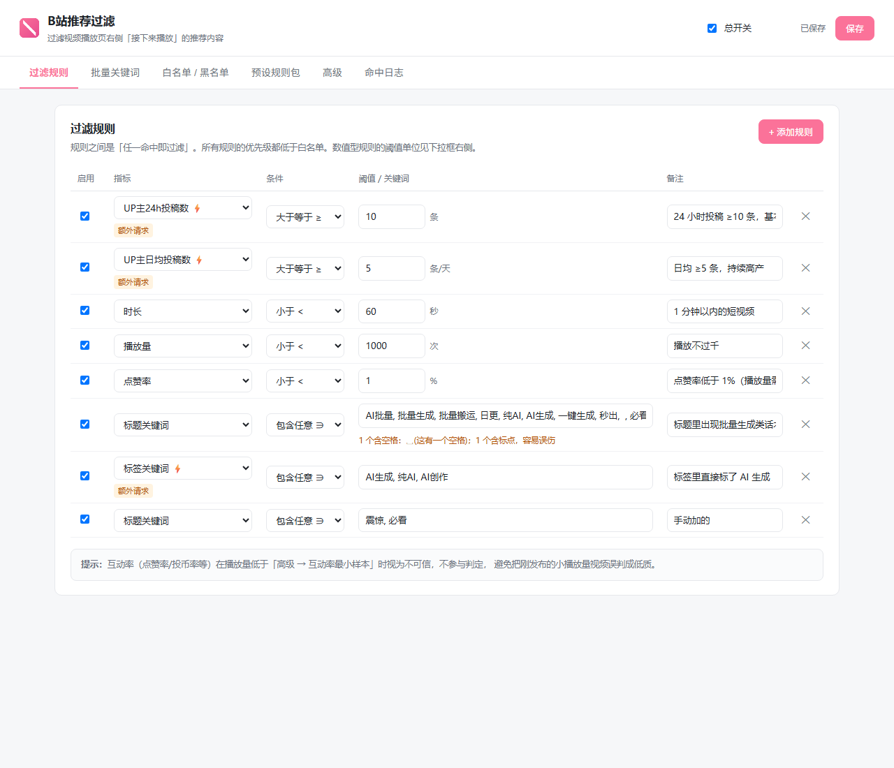
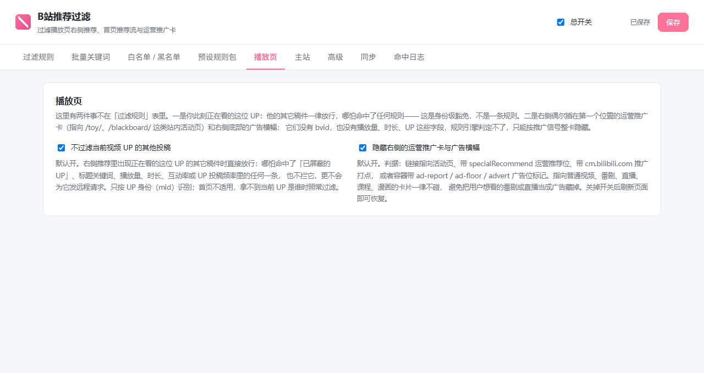

# B站推荐过滤 · Bili Recommend Filter

[](https://developer.chrome.com/docs/extensions/develop/migrate/what-is-mv3)
[](https://www.google.com/chrome/)
[](package.json)
[](package.json)
[](LICENSE)

Chrome 扩展（Manifest V3，零依赖、零构建），用来过滤哔哩哔哩**视频播放页右侧「接下来播放」推荐区**、**主站首页的推荐流**，以及播放页右侧偶发的**运营推广卡与广告横幅**。

**English** — A zero-dependency Chrome MV3 extension that filters the "Up next" recommendations on Bilibili video pages and the recommendation feed on the Bilibili homepage. Rules are declared in an editable table and applied to the page in real time: video duration, view count, like / coin / favorite / comment rates, title / uploader / tag keywords, partition, and how often the uploader posts. There is a whitelist and a blacklist, one-click "block this uploader" on any card, and a preset rule pack for cleaning up bulk-upload spam accounts. On the homepage you can additionally hide whole categories of non-video cards (bangumi, movies, courses, live streams, ads) with a switch each; on video pages a separate switch hides the occasional operation-promo card and the right-hand ad banner (matched by activity-page links, tracking domains and ad container classes, and never at the expense of bangumi / live / course cards). Load it unpacked from this folder — no build step, no `npm install`. Everything runs locally; the only network calls go to Bilibili's own public API (video tags, uploader posting frequency), and you can switch them off entirely in the advanced settings. Read the design notes in [AGENTS.md](AGENTS.md) (Chinese) before changing the filtering pipeline.

过滤维度：视频时长、播放量、点赞率/投币率/收藏率/评论率、标题关键词、UP 主名关键词、标签关键词、分区名、UP 主 24 小时 / 7 天投稿数与日均投稿数。关键词类指标都支持批量粘贴。另有 UP 主白名单 / 黑名单、一键「屏蔽此 UP」、预设规则包。

播放页上还有一个身份级豁免：**当前正在看的这位 UP 的其他投稿一律不过滤**，哪怕它命中了上面任何一条规则（含黑名单），也不会为它发额外请求。默认开，只作用于播放页与 `/list/` 系列页面，首页不适用，可在设置页「播放页」里关掉。

## 截图

| 过滤前 | 过滤后 |
| --- | --- |
|  |  |

悬停卡片右下角出现两个小图标，点「标题词+」展开成完整面板，标题被拆成可点的字块：


规则就是一张表，指标 + 条件 + 阈值，改完即时生效：



点扩展图标能看到这一页过滤了多少条、每条命中了哪条规则：


其余截图（预设规则包、批量关键词、白名单/黑名单、高级设置、命中日志、快捷按钮的收起与展开态）都在 [docs/screenshots](docs/screenshots)。

## 安装

1. 打开 `chrome://extensions`，右上角打开「开发者模式」
2. 点「加载已解压的扩展程序」，选择本目录
3. 打开任意 B 站视频播放页，右侧推荐区即开始按规则过滤

改完代码在扩展页点一下刷新按钮即可，不需要重新加载。

也可以在 [Releases](https://github.com/Purestblues/bili-recommend-filter/releases) 下载打包好的 zip，解压后同样用「加载已解压的扩展程序」载入。本扩展没有上架 Chrome 应用商店，所有分发都走源码。

## 权限与隐私

扩展只申请了三项能力：`storage` 用来存你的规则和白黑名单，`tabs` 用来在 popup 里找到当前标签页，以及 `api.bilibili.com` / `www.bilibili.com` / `space.bilibili.com` 三个域名的访问权。

同步是可选的：只有你自己在设置里填了 WebDAV 服务器并点了授权，扩展才会往那个地址读写一个 `settings.json`（详见下面的「WebDAV 多机同步」），不填就完全不会碰网络。除此之外它不联网。没有统计、没有埋点、没有作者服务器——规则在你浏览器里算，数据也只在浏览器本地。唯一的网络请求是给 B 站的公开接口（取视频标签、UP 主投稿频率），默认开启（否则这两个维度根本用不了），且有并发上限与缓存；在高级设置里把「允许额外请求」关掉，扩展就完全离线，只用页面自带的字段判定。导出的配置文件写到你自己选的本地路径，不经过任何第三方。

## 快速上手

装好后规则表是空的，什么都不会过滤。最快的方式是去「预设规则包」点一套：

- **清理 AI 批量号** — 24h 投稿 ≥10、日均 ≥5、时长 <60s、播放 <1000、点赞率 <1%、标题/标签含 AI 批量话术
- **低播放低互动** — 播放 <500 或点赞率 <0.5%
- **过滤超短视频 / 超长视频**
- **标题党话术** — 标题含「震惊/必看/99%的人…」
- **营销号 / 搬运号** — UP 名带搬运特征、7 天投稿 ≥30、标签含搬运

导入后就是普通规则，可以随便改、随便删。规则之间是「任一命中即过滤」（OR）。

调规则时看 popup 里的「本页命中」和设置页的「命中日志」，那里有每条视频具体命中了哪条规则、当时的数值是多少。

**关键词首尾的空格会被自动去掉**（不可见的空格会让词永远匹配不上），但**纯空格词会保留**——想过滤"标题里带空格"的视频，就直接填一个空格。词中间的空格不动，`Gemini 4` 这种短语可以正常用。

popup 和日志里的标题都是链接，点一下会在新标签页打开这个被屏蔽的视频——被规则挡住不等于你不想看，随手点开就行。

## 指标与规则

每条规则 = 指标 + 条件 + 阈值。数值型支持 `<` `≤` `>` `≥` `=` `介于`；关键词型支持 `包含任意`（不区分大小写）和 `正则匹配`，多个词用逗号或换行分隔。

| 指标 | 单位 | 说明 |
| --- | --- | --- |
| 时长 | 秒 | 视频总时长 |
| 播放量 | 次 | 累计播放 |
| 发布距今 | 小时 | 小于 24 即 24 小时内新投稿 |
| 点赞率 / 投币率 / 收藏率 / 评论率 | % | 对应互动数 ÷ 播放 × 100 |
| 标题关键词 / UP主名关键词 / 分区名 | — | 文本包含匹配 |
| 标签关键词 | — | 需额外请求（每条视频一次，缓存 7 天） |
| UP主24h投稿数 / 7天投稿数 / 日均投稿数 | 条 | 需额外请求（每个 UP 一次，缓存 1 小时） |

**互动率的样本下限**：播放量低于「高级 → 互动率最小播放量样本」（默认 1000）时，点赞率等视为不可信，不参与判定。这是为了防止刚发布的小播放量视频被误判成低质。

**白名单优先级最高**：命中的视频永远不会被过滤，白名单支持 UP 主 mid、UP 主名、标题词、标签词四种。其次是黑名单 UP（页面上一键屏蔽就存这里），最后才是规则表。

**关于「拿不到数据」**：如果某个视频的播放量、时长或互动数确实拿不到（页面结构特殊、接口被限流等），对应规则会**跳过判定**而不是按 0 处理。宁可漏掉一条，也不会因为「读不到播放量」就把整页推荐全判成低播放。

**命中后的处理方式**：默认是「隐藏」——用 CSS 把卡片藏起来，列表会自动上移，视觉上和删除一样，但不改页面的 DOM 结构。这一点很关键：直接删节点会让 B 站前端框架在下次渲染时找不到元素而报错，表现为页面重新渲染、播放中断。高级设置里仍保留了「彻底删除节点」选项，但不推荐。

## 保存

改完规则后右上角会出现「有未保存的修改」，点**保存**按钮（或按 `Ctrl+S`）就会立刻写入并立即生效，不用刷新页面。

其实改动也会自动保存，而且切到别的标签页时会强制落盘，正常用不会丢。保存按钮是给你一个确定性的兜底：点一下，一定存住。

## 备份与迁移

设置页「高级 → 配置备份 / 迁移」可以：

- **导出到文件** — 把规则、批量关键词、白名单、黑名单和高级设置一起存成一个 `bili-recommend-filter-YYYYMMDD.json`
- **从文件导入** — 选一个之前导出的 JSON，确认后覆盖当前配置
- **导出到文本框 / 从文本框导入** — 同样的内容，方便临时查看或粘贴给别人

导入前会弹出确认框，并显示将导入多少条规则、多少个白名单/黑名单 UP。文件格式不对会直接报错，不会清空你现有的配置。

## WebDAV 多机同步

如果你在两台以上机器上用，可以把「判定依据」同步起来：规则表、批量关键词、白名单、黑名单。播放页/主站的显示偏好、远程开关、命中日志**不同步**，每台机器可以各调各的。

在「同步」标签页填服务器地址、账号、应用密码（不是登录密码），点「保存并测试」，浏览器会弹一次授权确认——允许之后就能用了。以坚果云为例：地址是 `https://dav.jianguoyun.com/dav/`，应用密码在「账户信息 → 安全选项 → 添加应用密码」里生成。Nextcloud、群晖等其他 WebDAV 服务同理。

同步是双向合并而不是覆盖，所以两台机器各自加的规则都不会丢：A 机加的关键词、B 机加的规则，同步后两边都有。关键词比较特殊——同类型（比如「标题关键词」）的规则会按词表合并成一条，而不是变成两条看起来重复的规则。删除也会同步：一个词、一个 UP、一条规则被删掉后，另一台机器下次同步也会跟着删；这条删除记录在云端保留 30 天，过了就清理。

触发时机：**只在浏览器启动时自动同步一次**——启动后读云端、和本机合并、需要时推上去。平时改规则不会立刻上传，想马上同步就点「立即同步」（或者重新点一次「保存并测试」）。同步失败不会挡住任何本地功能，状态行会写出失败原因，并自动重试（认证错误不重试，免得把账号打进风控）。

云端目录里放两个东西：`settings.json`（当前的合并结果）和 `backup/settings-<数字>.json`（每次推送前的旧版本，最多 10 份）。凭据只存在本机，不进同步文件，也不会被打进「导出配置」。

## 页面快捷操作

鼠标移到右侧推荐卡片上，**卡片的右下角**会出现两个小图标，尽量不挡封面和标题（方便你先预览、或者在标题上悬停看全名）：

- ⊘ **屏蔽此UP** — 把该 UP 的 mid 和名字加进黑名单
- ✎ **标题词+** — 展开面板，从标题里点字拼关键词

点「标题词+」才会展开成完整面板。展开后会盖住卡片内容，但用完点 ✕ 或按 `Esc` 就收起来，回到小图标状态。

两个操作都会即时重判当前页，不用刷新页面。

### 从标题里点字拼关键词

点「标题词+」后，工具栏下方会展开当前视频的标题，标题被拆成一个个可点的字块：中文一个字一块，英文和数字保持整词（`GitHub`、`50.9k`），标点单独一块，空格显示成 `␣`。

点字就把它追加到下面的输入框，**同一个字可以反复点**，也可以跨位置组合——比如标题里「吃」和「爽」没有挨着，你也能先点「吃」再点「爽」拼出「吃爽」。

拼好一个词，手动打一个中文逗号「，」或英文逗号「,」分隔，再拼下一个。输入框下方会实时显示切分结果，确认无误按回车提交。

例：输入框里是 `辣椒，饼,主食，爽爆,吃爽`，提交后就是 5 个过滤词：辣椒、饼、主食、爽爆、吃爽。

几个约定：

- 只有中英文逗号是分隔符，其他符号都算词的一部分
- 连续逗号（`,,`）中间是空的，不会产生空词
- **不会自动去空格**——空格本身可以是一个过滤词，这是有意为之
- 词里含标点会被标黄并提示「容易大范围误伤」，仍然允许提交
- 空格看不见，所以凡是显示关键词的地方都会用 `␣` 标出空白并补一句 `(这有一个空格)`。这句话只是提示，**永远不会被当成关键词存进去**

**加进去的东西在哪看**：设置页会自动同步（不用重开）。「屏蔽此UP」写在「白名单 / 黑名单 → 黑名单 · 已屏蔽的 UP」的两个框里；「标题词+」写进「过滤规则」里那条「标题关键词 包含任意」的规则，「批量关键词 → 标题关键词」页也能看到同一批词。想删就在对应位置删掉即可。

注意「标题词+」加的是**标题关键词过滤规则**——添加后，所有标题含这个词的推荐都会消失，所以别加太泛的词。

## 主站首页

除了播放页，`www.bilibili.com` 首页的推荐流也会按同一套规则过滤。设置页多了一个「主站」标签页：

- **在首页也过滤推荐**：默认开启。关掉后首页完全不管，规则表仍然作用在播放页。
- **首页也使用需要额外请求的指标**：默认关闭。标签关键词和 UP 主投稿频率要逐条请求接口，而首页会无限滚动、卡片数量没有上限——开着它容易把单页预算吃光，也更容易撞风控。开启后也只对滚到视口附近的卡片发请求。
- **按类别隐藏**：番剧/国创、影视/纪录片、漫画、课程/课堂、直播、赛事、广告、推广/商业推广各一个开关，勾上就整类不显示。

首页上点扩展图标，popup 会显示「推荐 / 已过滤 / 额外请求」三个数字和本页命中列表，被过滤的标题同样是可点的链接。

为什么这些类别卡不能像普通视频那样按规则过滤：它们没有 bvid，或者元数据不全，规则引擎拿不到东西判定，所以只能按类别整类隐藏。默认全关，因为一装上就把番剧和直播全藏掉太激进。

判定用的证据不止一种：漫画卡指向 `manga.bilibili.com`；**赛事卡其实就是普通视频卡**（链接是 `www.bilibili.com/video/BV…`），只能靠卡面那个「赛事」角标识别；**推广卡**则看它里面是不是有指向 `cm.bilibili.com`（B 站商业推广的打点域）的链接或属性——这类卡片不一定带「广告」标记，也可能根本没角标。所以同一套开关背后是三套判据：角标文案、链接指向、打点域。勾上之后如果哪天不生效，先看 B 站是不是把角标文案或打点域改了。

首页上被过滤掉的卡片会真正从网格里收走（下面的卡片上移补位），而不是留一个空格子。这一点专门处理过：只把卡片本体隐藏的话，整行被过滤后下面所有行会原地不动，留下 210px 的空白，所以命中时会连卡片外面那层等高容器一起藏。

## 播放页右侧的推广卡

右侧推荐区偶尔会把第一个位置换成一张运营推广卡（指向 `/toy/`、`/blackboard/` 这类站内活动页），右侧底部还常有一条广告横幅。它们没有 bvid、没有播放量/时长，规则引擎什么都取不到，所以不归「过滤规则」表管，而是在设置页多了一个「播放页」标签页，里面一个开关：**隐藏右侧的运营推广卡与广告横幅**，默认开。

判据都是能在链接或 class 上看到的硬信号：链接带 `specialRecommend`（运营推荐位）、指向 `/toy/`、`/blackboard/`、`/festival/` 活动页、带 `cm.bilibili.com` 推广打点或 `adfloor` 打点，或者容器带 `ad-report`、`ad-floor`、`advert` 广告位标记。



反过来，指向普通视频、番剧、直播、课程、漫画的卡片一张都不碰——哪怕它带了 `specialRecommend` 参数。宁可漏杀，不可把你想看的番剧或直播卡当广告藏掉。关掉开关后不用刷新页面，被藏的卡片会立刻回来。

## 当前 UP 的投稿不会被过滤

在播放页上看某个 UP 的视频，本身就说明你此刻想看这位 UP，所以右侧「接下来播放」里这位 UP 的**其他投稿一律放行**：哪怕它命中黑名单、标题关键词、播放量、时长、互动率或 UP 投稿频率里的任何一条，也不拦它，更不会为它发标签 / 频率请求。

它不是一个指标或一条规则，而是判定前的短路，所以优先级比黑名单还高。设置页「播放页」里有一个开关（**不过滤当前视频 UP 的其他投稿**，默认开），关掉就完全回到旧行为，不用刷新页面。

只认 UP 身份，不看你命中的是哪条规则；识别当前 UP 优先用页面自带的初始数据（播放页的 `upData` / `videoData.owner`，`/list/` 页从列表里按当前 bvid 找），拿不到时才从页面上 UP 名字旁边的空间链接里抠。所以有两个边界要看清楚：**首页不适用**（没有「正在播放的视频」这个概念）；**拿不到当前 UP 是谁时照常过滤**（宁可漏豁免，不可误放）。

## 关于额外请求与风控

标签关键词和 UP 主投稿频率这两个维度必须额外请求 B 站接口，是唯一有代价的部分。默认做了这些保护：

- 标签并发 2、间隔 150ms；UP 频率串行、间隔 500ms；每个播放页有请求上限（默认 40 次，可在高级里调低）
- 缓存：标签 7 天、UP 频率 1 小时、related 10 分钟
- 撞到风控（-352 / -412 / -509）会指数退避，冷却期内相关规则直接判为「未知」并**放行**，不会误杀
- 高级里可以把「允许额外请求」整个关掉，此时只用接口自带字段判定，零额外请求

关闭后这两个维度的规则完全不生效，其余规则不受影响。

## 已知限制

广告卡不归规则引擎管：它们没有 bvid，拿不到时长/播放量，所以只能按「推广信号」整卡隐藏（见上面「播放页右侧的推广卡」），不能写成一条按指标过滤的规则。B 站如果把推广位换成新的活动页路径或新的广告位 class 名，判据需要补一条。

过滤只作用于播放页右侧推荐区与主站首页推荐流，不涉及评论区、自动连播的候选队列。

B 站前端改版可能影响 DOM 适配与数据来源。适配点集中在三处，见 `AGENTS.md` 的「已知脆弱点」。

WebDAV 同步是「逐条记录取新」的合并策略：同一条规则在两台机器上同时改，后改的那次会赢，不会两边都留。关键词是按词合并的，所以互不冲突。

坚果云不允许通过 WebDAV 删除目录（`DELETE` 一个空集合也返回 403），所以换远端目录后旧目录会留在云盘里，需要手动清理；扩展本身只删文件。

## 手动验收清单

自动化测试覆盖了规则引擎与推广判据（169 项）、真实浏览器端到端流程（35 项）、主站首页（24 项）与播放页推广卡（19 项），但下面这些需要你本人确认一遍：

1. 装好后打开任意播放页，右侧推荐区正常显示，顶部导航栏和播放器都在，没有卡片被无故隐藏
2. 去预设页导入「清理 AI 批量号」，刷新页面，右侧明显少了一些 AI 批量号视频，剩下的卡片紧挨着排列、没有大片空白
3. 鼠标移到某张卡片上，出现「屏蔽此UP」；点一下，该 UP 的视频立即全部消失
4. 点「标题词+」，输入一个你确定出现在某张卡片标题里的词，回车，那张卡片消失
5. 点扩展图标，popup 里「推荐条数 / 已过滤 / 额外请求」三个数字合理，「本页命中」列出了被过滤的视频和原因
6. 在设置页把总开关关掉，被过滤的卡片会恢复（不需要刷新）
7. 在设置页改一条规则的阈值，保存后回到播放页，过滤结果随之变化
8. 打开「允许额外请求」，加一条「UP主7天投稿数 ≥ 10」，等待几秒，高产的 UP 的视频被过滤；同时看「额外请求」计数有没有涨
9. 改一条规则的阈值，点右上角「保存」，关掉浏览器再打开，值应该还是你改的那个
10. 在「高级 → 配置备份」点「导出到文件」，应该下载一个 json；改几条规则后再「从文件导入」这个 json，配置应该恢复原样
11. 打开 `www.bilibili.com` 首页，加一条「播放量 < 1000」或「时长 < 60」，首页推荐里应该少一批卡片，剩下的卡片紧挨着排列、没有整行空白
12. 去「主站」标签页勾上「直播」和「广告」，刷新首页，直播间和广告卡应该消失；取消勾选后回来
13. 回到播放页，把右侧滚到底：如果有推广卡或广告横幅，默认应该已经被藏掉；去「播放页」标签页关掉开关，它们应该立刻回来（不用刷新）
14. 在「同步」标签页填你自己的 WebDAV，点「保存并测试」，浏览器弹权限时点「允许」，状态行应显示连接正常；再加一条规则，点「立即同步」，另一台机器（或浏览器另一个 profile）启动后应该能看到这条新规则
15. 在 A 机删掉一个关键词并点「立即同步」，B 机重启后同步一次，那个词应该也消失了

## 开发

不需要 `npm install`（这里没有依赖），只要能跑 `node`（建议 20 以上，脚本用了 `import.meta.dirname`）。

```
npm test         # 规则引擎 + 推广判据 + 当前 UP 豁免单测（185 项，用真实接口数据快照，纯 Node 不启浏览器）
npm run check    # 所有源文件语法检查
npm run e2e      # 真实 Chrome + 真实播放页端到端（36 项，需要联网）
npm run videoad  # 播放页侧栏推广卡：活动页广告 / 广告横幅 / 对照组不被误藏（19 项，需要联网）
npm run exempt   # 当前 UP 豁免：全 UP 拉黑后同 UP 的卡仍可见 / 关开关后失效（18 项，需要联网）
npm run save     # 保存可靠性：点保存/切走/关浏览器重启（13 项）
npm run picker   # 标题拆字选词 → 逗号切分 → 提交（23 项）
npm run quick    # 页面快捷按钮 + 设置页同步（15 项）
npm run popup    # popup 命中列表的标题链接（15 项）
npm run backup   # 导出/导入本地文件（17 项）
npm run fallback # 关键词首尾空格 + 元数据缺失兜底 + 晚到重判（15 项）
npm run home     # 主站首页端到端（24 项，需要联网）
npm run sync     # WebDAV 同步：合并/删除传播/墓碑回收 + 真服务器双机演练 + 真浏览器自动同步（45 项）
npm run verify   # WBI 签名与接口连通性专项检查
npm run pack     # 打发布 zip 到 out/bili-recommend-filter-<版本>.zip
```

除了 `npm test` 和 `npm run check`，其余脚本都会启动一个真实的 headless Chrome 并通过 CDP 加载本扩展。它们会自己找 Chrome（Windows 注册目录、macOS `/Applications`、Linux `/usr/bin` 与 PATH 都会试），找不到或者你想指定别的浏览器（Edge、Chromium 也行）就设环境变量：

```
# Windows PowerShell
$env:BRF_CHROME='C:\Program Files\Google\Chrome\Application\chrome.exe'
# macOS / Linux
export BRF_CHROME=/Applications/Google\Chrome.app/Contents/MacOS/Google\Chrome
```

`tools/diagnostics/` 下是一批一次性诊断脚本，B 站改版或规则不生效时用得上：`probe-dom` 采样过滤效果（看是收敛还是反复回流）、`probe-net` 抓页面实际请求确认数据来源、`probe-state` 定位 SSR 状态对象结构、`probe-keyword` 逐字比对关键词为什么没命中、`probe-352` 排查风控、`probe-hydration` 对比隐藏与删除节点是否引发页面报错。它们不是测试，不会自动跑，也不会在 CI 里跑。

跑同步测试要真服务器，凭据只从环境变量读（脚本里没有任何账号）：

```
export BRF_WEBDAV_URL='https://dav.jianguoyun.com/dav/'
export BRF_WEBDAV_USER='你的账号'
export BRF_WEBDAV_PASS='应用密码'
npm run webdav   # 缺变量会直接失败；npm run sync 在缺变量时跳过网络部分
```

设计决策与踩坑记录见 [AGENTS.md](AGENTS.md)，改过滤链路之前建议先读一遍。

## 贡献

欢迎提 Issue 和 PR。改规则引擎（`src/lib/rules.js`、`src/lib/metrics.js`）请顺手补上 `tools/test-rules.mjs` 的用例，改 DOM 适配请说明是在哪个页面形态上验证的（`/video/BVxxx`、`/list/watchlater`、`/list/xxx?type=series` 的数据源不一样）。如果 E2E 因为连续运行撞上 B 站的 `-412` 风控而失败，等一段时间再跑。

## 许可证

[MIT](LICENSE) © 2026 Purestblues。这个扩展只是调整你本地的页面显示，不下载、不转存、不再分发任何 B 站内容。

